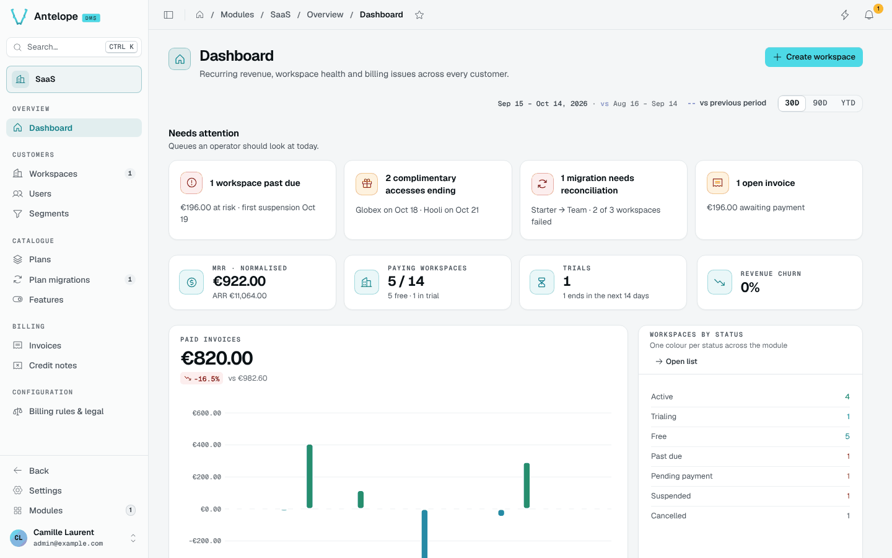

<div align="center">

# @antelopejs/dms-saas

<a href="https://www.npmjs.com/package/@antelopejs/dms-saas"></a>
<a href="./LICENSE"></a>
<a href="https://discord.gg/sjK28QHrA7"></a>
<a href="https://dms.antelopejs.com/docs/modules/saas"></a>

Sign-up, plans, Stripe billing and a back office for a multi-tenant AntelopeJS DMS.

</div>



## What it does

- Adds public pricing and registration screens, legal pages, and a completion screen for OAuth sign-ins.
- Defines plans whose permissions cap what each workspace can do, with features, limits, trials and seat pricing.
- Bills through Stripe: checkout, subscriptions, invoices, credit notes, refunds and Stripe Tax, with plans kept in sync.
- Gives workspace owners their settings: general, members, billing and data export.
- Gives the platform owner a back office: workspaces, users, segments, plan migrations, billing rules and legal documents.

## Install

Run the AntelopeJS CLI from the root of a project that loads `@antelopejs/dms` in multi-tenant mode, with an e-mail module and a file storage:

```bash
ajs project modules add @antelopejs/dms-saas
```

## Quick start

Give the module its Stripe keys from the environment:

```ts
// antelope.config.ts
export default defineConfig({
  name: "my-saas",
  envOverrides: {
    STRIPE_SECRET_KEY: "modules.dms-saas.config.stripe.secretKey",
    STRIPE_PUBLISHABLE_KEY: "modules.dms-saas.config.stripe.publishableKey",
    STRIPE_WEBHOOK_SECRET: "modules.dms-saas.config.stripe.webhookSecret",
  },
  modules: {
    "dms-saas": {
      source: { type: "package", package: "@antelopejs/dms-saas", version: "^0.6.0" },
      config: {
        stripe: {
          secretKey: "sk_test_placeholder",
          publishableKey: "pk_test_placeholder",
          webhookSecret: "whsec_placeholder",
        },
      },
    },
    // dms, api, mongodb, auth-jwt, nodemailer, file-storage-local, ...
  },
});
```

Then point a Stripe webhook at `https://<api>/api/saas/webhooks/stripe`, set `DMS_AUTH_ESTABLISH_ENDPOINTS=/api/saas/register/finalize` in the frontend server's environment, and publish a free plan in **Modules › SaaS › Plans**: registration opens every workspace on it. With placeholder keys the module still runs, and the Stripe-backed blocks say so.

## Compatibility

| Package | Version |
| --- | --- |
| `@antelopejs/dms` | `>=0.11.0 <1.0.0` |
| `@antelopejs/interface-dms` | `>=0.9.0 <1.0.0` |
| `@antelopejs/dms-frontend` (renderer) | `>=0.9.0 <0.10.0` |
| `@antelopejs/interface-dms-saas` | `>=0.6.0 <0.7.0` |
| Stripe API version | `2026-08-26.dahlia` |

On DMS 0.10 or earlier, use `@antelopejs/dms-saas` 0.8. Before upgrading an existing database, read [Upgrading](https://dms.antelopejs.com/docs/modules/saas/faq#upgrading).

## Packages

| Package | Directory | Role |
| --- | --- | --- |
| [`@antelopejs/dms-saas`](https://www.npmjs.com/package/@antelopejs/dms-saas) | [`packages/dms-saas`](./packages/dms-saas) | The module: public screens, plans, billing, workspace settings and back office. |
| [`@antelopejs/interface-dms-saas`](https://www.npmjs.com/package/@antelopejs/interface-dms-saas) | [`packages/interface-dms-saas`](./packages/interface-dms-saas) | The extension points modules use to build on dms-saas. |

## Documentation

- [Consumer reference](./packages/interface-dms-saas/docs/1.index.md)
- [Introduction](https://dms.antelopejs.com/docs/modules/saas/introduction)
- [Installation](https://dms.antelopejs.com/docs/modules/saas/installation)
- [Configuration](https://dms.antelopejs.com/docs/modules/saas/configuration)
- [Usage](https://dms.antelopejs.com/docs/modules/saas/usage/public-screens)
- [Extending](https://dms.antelopejs.com/docs/modules/saas/extending)
- [FAQ](https://dms.antelopejs.com/docs/modules/saas/faq)
- [Stripe](https://dms.antelopejs.com/docs/modules/saas/stripe)
- [Operations](https://dms.antelopejs.com/docs/modules/saas/operations)

The guide's sources live in [`packages/dms-saas/docs`](./packages/dms-saas/docs). The module ships the `dms-saas` Claude Code skill in [`packages/dms-saas/skills`](./packages/dms-saas/skills), declared under `antelopeJs.skills`.

## Contributing

Read [CONTRIBUTING.md](./CONTRIBUTING.md) before opening a pull request. One install from the repository root includes the backend, interface and shipped Vue frontend. The root lockfile covers this workspace; the frontend retains its lockfile for standalone consumers. The playground remains independent: its private dependencies require registry access and are deliberately not installed by CI.

The playground connects to MongoDB at `mongodb://localhost:27017` unless `MONGO_URL` is set, in the environment or in `packages/dms-saas/playground/.env`, and seeds a data set on its first start (sign in as `admin@example.com` / `Playground-Admin-1!`).

```bash
pnpm install --frozen-lockfile
# Only for local playground development, with private registry access:
pnpm --dir packages/dms-saas/playground install --frozen-lockfile --ignore-workspace
cd packages/dms-saas
pnpm build
pnpm dev            # playground backend on http://localhost:5010
pnpm frontend:dev   # dashboard on http://localhost:3001, in a second terminal
pnpm lint
pnpm typecheck
pnpm test
pnpm test:frontend  # builds the client, SSR and e-mail bundles in a temporary workspace and typechecks them
```

<details>
<summary>Repository notes</summary>

- The module registers `frontend-vue/dms.frontend.ts` with the Vue 3 renderer. It keeps the `DmsSaas*` component names, the `auth/no-workspace` page override, client-only displays, global guards and the English and French catalogs. Public module configuration is exposed under `public.dmsSaas`; Stripe secrets never reach the frontend.
- Frontend source verification runs through `@antelopejs/dms-frontend` and the DMS frontend source shipped in the published `@antelopejs/dms` package; no sibling checkout is needed.
- Sign-in with GitHub and Google in the playground reads `GITHUB_CLIENT_ID`, `GITHUB_CLIENT_SECRET`, `GOOGLE_CLIENT_ID` and `GOOGLE_CLIENT_SECRET`: a provider's button appears once both of its values are set, with `http://localhost:3001/auth/oauth/<provider>/callback` as its callback URL.
- The module implements the interface, so it depends on it through `>=<interface version> <0.<minor + 1>.0`. Release the interface on its own workflow before the module.

</details>

## License

[Apache-2.0](./LICENSE)
