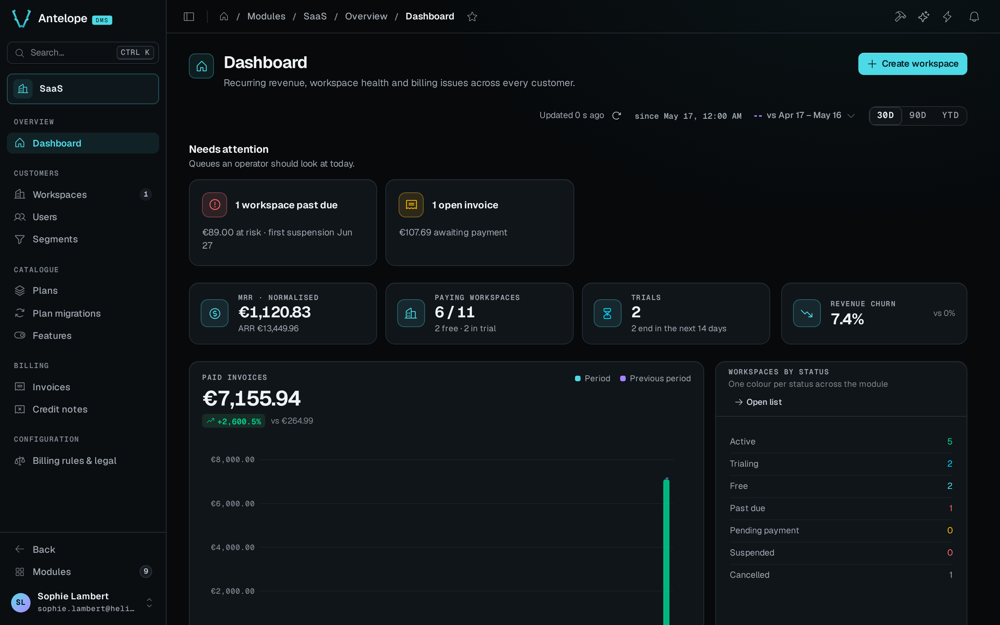

`@antelopejs/dms-saas` turns a multi-tenant DMS project into a product people can sign up for and pay. It adds public sign-up and pricing screens, a plan catalogue whose permissions cap what each workspace can do, Stripe subscriptions and invoices, workspace settings for customers, and a back office where the platform owner runs the business.

## What it brings

::card-group
  ::card{title="Self-service sign-up" icon="i-lucide-user-plus" to="/docs/modules/saas/usage/public-screens"}
  Pricing, registration with an optional card, legal pages, and a completion screen for OAuth sign-ins.
  ::

  ::card{title="Plans that gate features" icon="i-lucide-layers" to="/docs/modules/saas/usage/plans"}
  Plans list the permissions a workspace gets, with features, limits, trials and seat pricing.
  ::

  ::card{title="Stripe billing" icon="i-lucide-credit-card" to="/docs/modules/saas/stripe"}
  Checkout, subscriptions, invoices, credit notes, refunds, Stripe Tax, and plans kept in sync with Stripe.
  ::

  ::card{title="Back office" icon="i-lucide-building-2" to="/docs/modules/saas/usage/workspaces"}
  Workspaces in every billing state, users, segments, plan migrations, billing rules and operator actions.
  ::
::

## Start with one free workspace

A first integration aims at one result. A visitor registers, lands in a workspace on your free plan, and sees the permissions that plan grants.

[Installation](/docs/modules/saas/installation) covers the module, the Stripe keys and an active free plan open to individuals. For a local trial without Stripe, set [`registration.paymentMethod`](/docs/modules/saas/configuration#registration) to `none`, because placeholder Stripe keys alone do not hide the card step. A test account registered at `/register` then shows the free plan, without a Stripe customer, in **Settings › Workspace › Billing**. Paid plans come after that. [Stripe](/docs/modules/saas/stripe) explains checkout, webhook setup and price synchronization.

The playground already holds sample customers and billing records. It shows every screen, but its Stripe IDs are fake, so it does not prove a payment flow.

## Who uses each surface

| Who | Where | What they do |
| --- | --- | --- |
| Visitors | `/pricing`, `/register`, `/auth/no-workspace`, legal pages | Compare plans, create an account and its first workspace |
| Workspace owners and members | **Settings › Workspace** (General, Members, Billing, Data export) and the workspace switcher | Rename the workspace, manage seats, change plan, pay, export data |
| Platform owner | **Modules › SaaS** (`/modules/saas/...`) | Follow revenue, manage workspaces and plans, configure billing rules and legal documents |

## How plans gate the product

Each workspace holds one subscription to a plan, and a plan lists permission IDs. For every member, the `dms-saas.plan-intersection` resolver keeps only the permissions that the plan grants. It gives the workspace owner every permission of the plan. Once the catalogue has a free plan, a workspace never stays without a plan, because the module attaches the default free plan to any workspace without a subscription. See [Extending](/docs/modules/saas/extending#tenant-owner-permissions).

::note
The module builds on the core DMS multi-tenancy. Read [SaaS mode](/docs/auth-and-tenancy/saas-mode) in the core documentation for the tenant model it extends.
::
