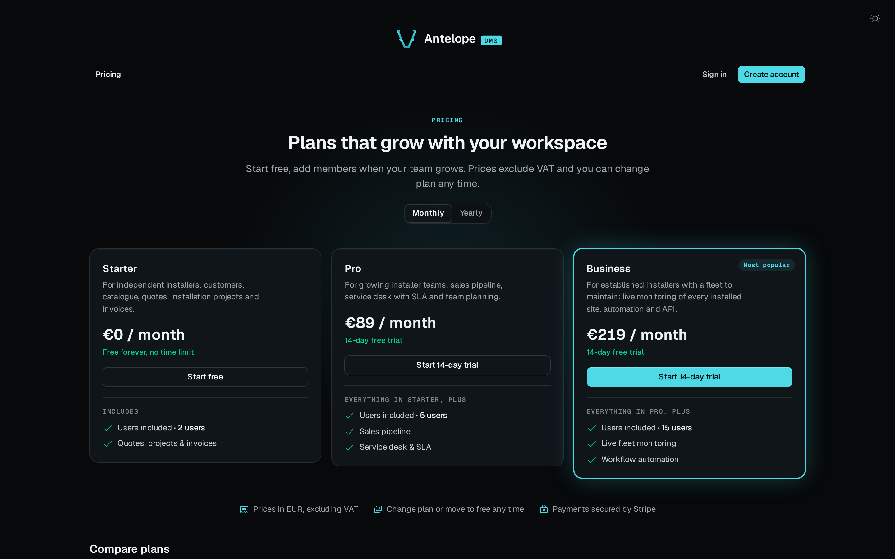
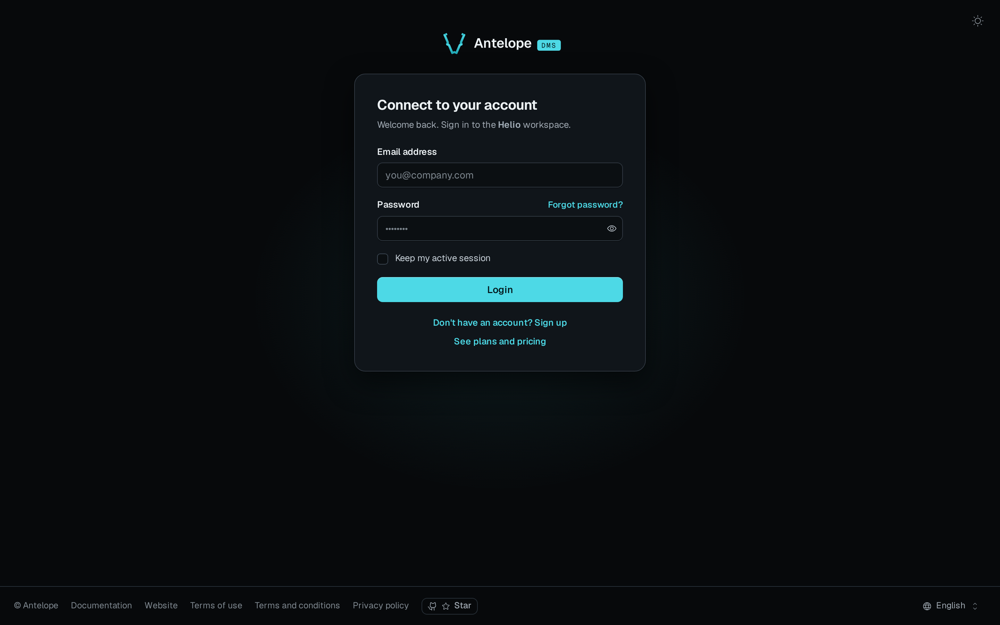
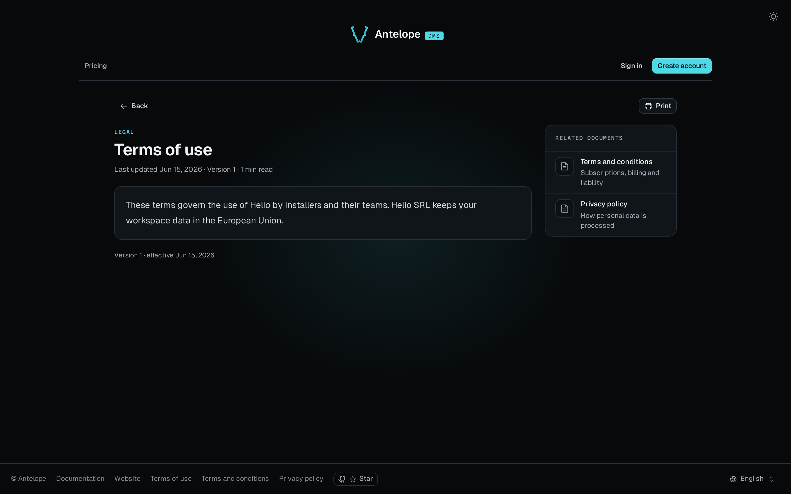

`dms-saas` ships public screens that a fresh project can sell with as soon as it starts. They are a reference implementation. The module owns the money and the compliance of the flow, and your product owns the conversion. You can [replace them](/docs/modules/saas/extending#public-screens).

## Pricing

`/pricing` lists the plans that are on sale and public, in catalogue order. Each card shows the price, the trial and the features, with a call to action: **Start free**, **Start N-day trial** or **Choose** followed by the plan name. A **Monthly** and **Yearly** switch changes the billing interval shown. Below the cards, **Compare plans** sets every limit side by side, and **Questions about billing** answers questions on renewal, VAT, plan changes and the money-back guarantee. The sign-in page links to it with **See plans and pricing**.

## Registration

`/register` creates an account and its first workspace on the default free plan. The form asks for the full name, the e-mail address and a password that the DMS password policy checks. The visitor accepts the terms and conditions and the privacy policy. `registration.paymentMethod` decides the card step. `required` always asks for a card, `optional` lets the visitor add one later, and `none` never asks. Stripe saves the card. The customer type, the billing address and the VAT number belong to the upgrade flow.

A visitor who chose a plan on Pricing reaches `/register?plan=<plan>`. The form names that plan. The workspace still opens on the free plan. When the chosen plan is paid, the visitor signs in and lands on the upgrade review of that plan on the Billing page.

Under `admissionMode: "invitation-only"`, the screen shows **Registration is closed** with a **Sign in** button, and the sign-in page drops its sign-up link.

## Sign-in

The DMS sign-in page (`/auth`) gains two links. **Don't have an account? Sign up** leads to `/register`, and **See plans and pricing** leads to `/pricing`. Each link shows only when the deployment serves that screen. The sign-up link also needs an open admission mode.

## Completing a sign-up without a workspace

An account can reach the product before it belongs to a workspace. It happens after an OAuth sign-in for an unknown e-mail address, and after any entry point the DMS answers with `requires_tenant_assignment`. The `auth/no-workspace` page, **Set up your first workspace**, asks for a workspace name. It opens that workspace on the free plan, with a card when `registration.paymentMethod` asks for one, and lands the visitor signed in.

The page never touches the tokens. It posts through the frontend loader's `POST /auth/establish` route. The loader calls `/api/saas/register/finalize` server-to-server and writes the session cookie. The loader calls only the endpoints a module declares or the frontend server's `DMS_AUTH_ESTABLISH_ENDPOINTS` names, and answers `403` for any other. `dms-saas` declares `/api/saas/register/finalize` itself through `authEstablishEndpoints` on its frontend module, so a standard deployment needs no configuration.

## Legal pages

`/terms-of-use`, `/terms-and-conditions` and `/privacy-policy` render the legal documents edited in [Billing rules & legal](/docs/modules/saas/usage/billing-rules). The footer links all three. The registration checkbox links the terms and conditions and the privacy policy.

A legal page shows the formatting the editor writes: headings, paragraphs and their alignment, bold, italic, underline, strikethrough, lists, quotes, code and links. Anything else in a stored document is left out: scripts, event handlers, embedded frames, images, inline styles other than alignment, and links that are not `http`, `https`, `mailto`, `tel` or relative.

## Suspended workspace

Members of a workspace whose subscription blocks access land on `/workspace-suspended`, **Workspace access restricted**. The page says why the workspace is closed. The reasons are an unpaid invoice, a suspension, a first payment still pending, a cancelled subscription, a deletion by an owner, and the end of a complimentary access. Suspension does not always come from an unpaid invoice, because an operator can also suspend a free workspace. While the workspace is suspended, its data and files are kept. After a cancellation or a deletion, the page shows the date the data is deleted.

An owner gets the way back for the reason shown, such as **Pay invoice**, **View billing**, **Complete payment** or **Choose a plan**. A member who is not an owner is told to ask the owner, with an **Email** button. Both can press **Check again** once access is restored, or open another of their workspaces. The [suspension and recovery walkthrough](/docs/auth-and-tenancy/saas-mode#follow-suspension-through-recovery) shows the restriction screen and the Billing page that stays reachable. That example uses an operator's reactivation of a free workspace. It does not show a Stripe payment recovery.
