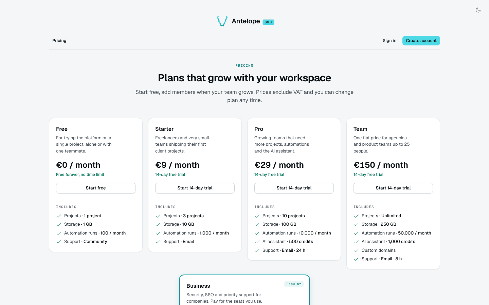
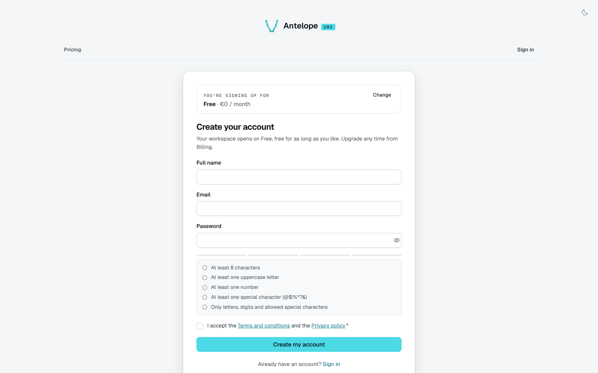
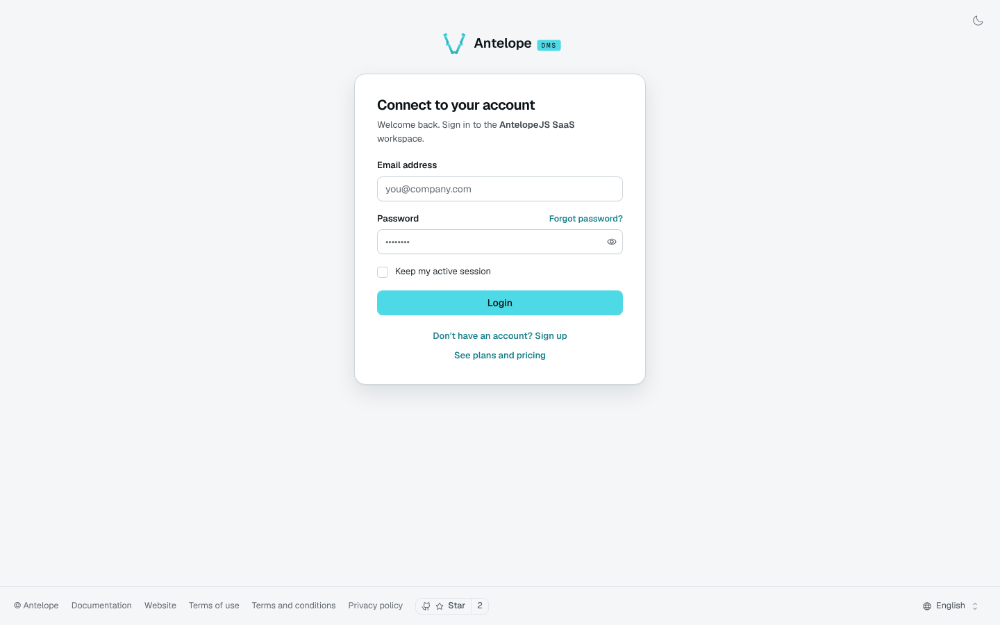
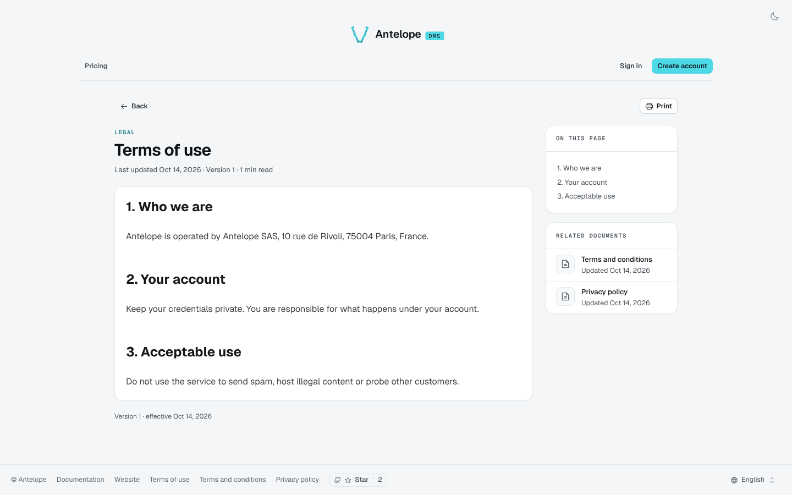

# Public screens

dms-saas ships working public screens so a fresh project can sell from day one. They are a reference implementation: the module owns the money and the compliance of the flow, your product owns the conversion. You can [replace them](/docs/modules/saas/extending#public-screens).

## Pricing

`/pricing` lists the public plans in catalogue order, with their price, trial and features, and a call to action per plan. The sign-in page links to it.

## Registration

`/register` creates an account and its first workspace on the default free plan: name, e-mail, a password checked against the DMS policy, the acceptance of the terms and, depending on `registration.paymentMethod`, a card saved by Stripe. Plan choice, customer type, billing address and VAT number belong to the upgrade flow.

Under `admissionMode: "invitation-only"`, the screen shows a "registration by invitation only" state, and the sign-in page drops its sign-up link.

## Sign-in

The DMS sign-in page (`/auth`) gains links to sign up and to the pricing page.

## Completing a sign-up without a workspace

An account can reach the product before it owns a workspace: an OAuth sign-in for an unknown e-mail, or any entry point the DMS answers with `requires_tenant_assignment`. The `auth/no-workspace` page opens its first workspace on the free plan, with a card when `registration.paymentMethod` asks for one, and lands the visitor signed in.

The page never touches the tokens: it posts through the frontend loader's `POST /auth/establish` route, which calls `/api/saas/register/finalize` server-to-server and writes the session cookie. That route only calls the endpoints the deployment names, hence `DMS_AUTH_ESTABLISH_ENDPOINTS=/api/saas/register/finalize` in the frontend server's environment; without it, the loader answers `403` and the visitor stays signed out.

## Legal pages

`/terms-of-use`, `/terms-and-conditions` and `/privacy-policy` render the legal documents edited in [Billing rules & legal](/docs/modules/saas/usage/billing-rules). Registration links to them.

## Suspended workspace

Members of a suspended workspace land on a page explaining that access is paused until the invoice is paid. Data and files are kept.
