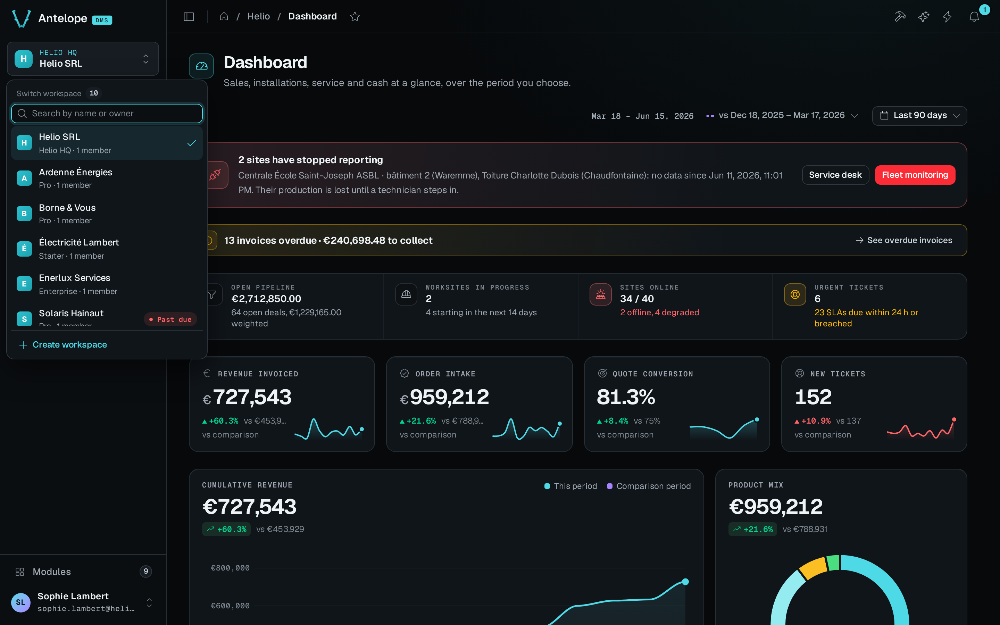
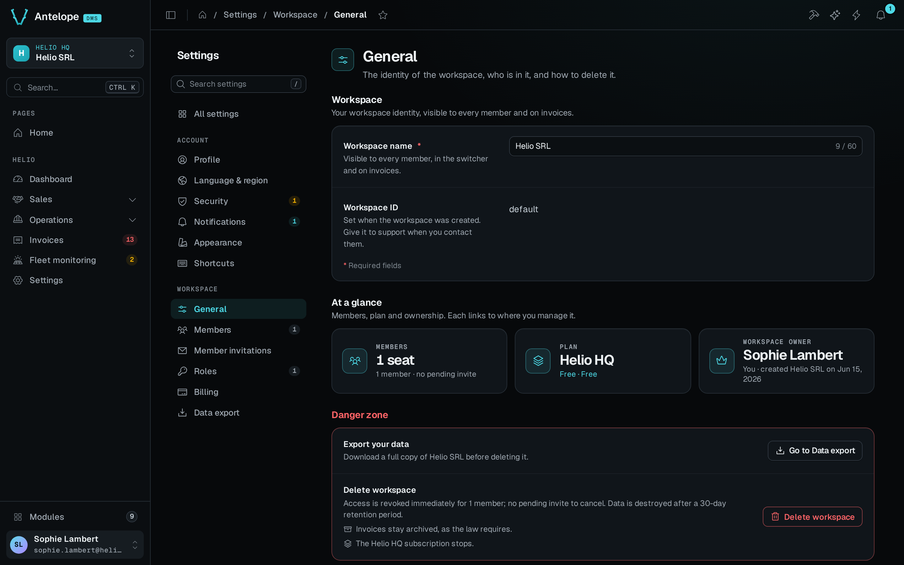
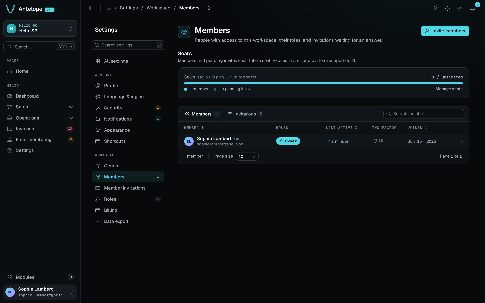
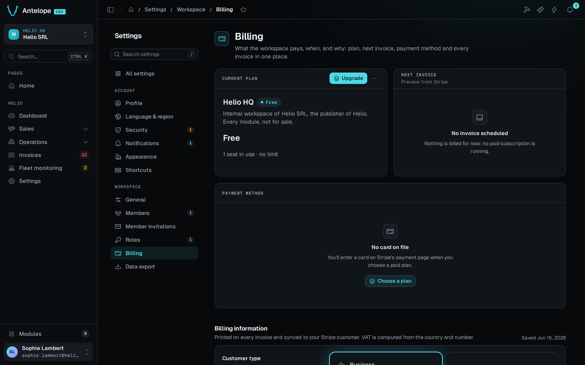
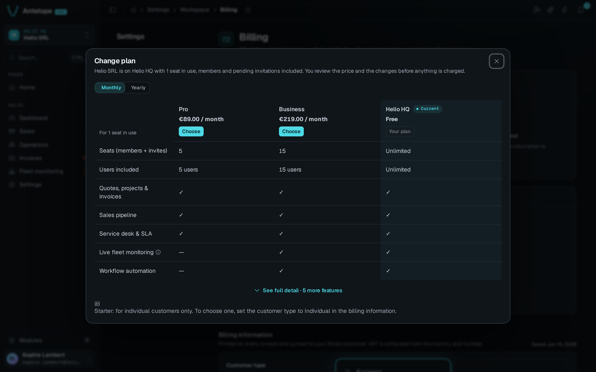
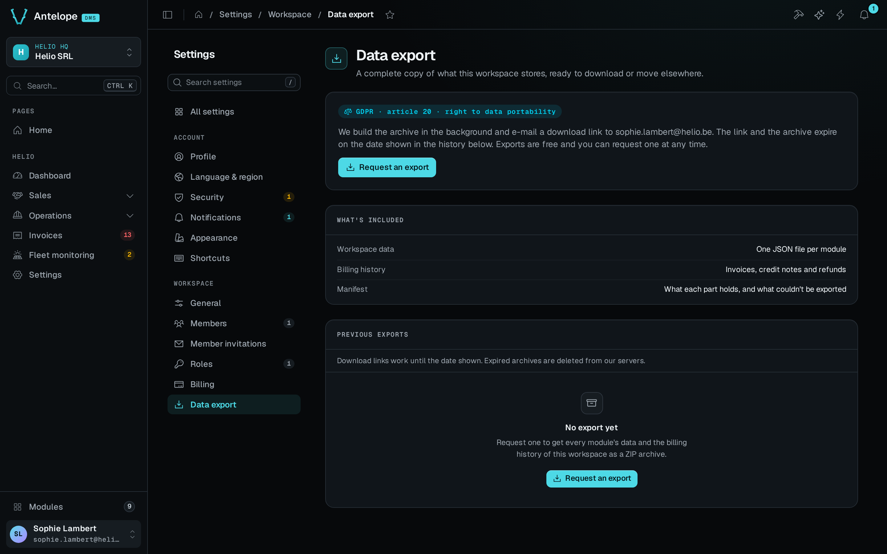

`dms-saas` adds its pages to the DMS **Settings › Workspace** section and a workspace switcher to the sidebar. Your customers use these screens.

## Workspace switcher

The switcher at the top of the sidebar shows the current workspace and its plan. It lists the other workspaces of the account, with a search by name or owner, and offers **Create workspace**. The creation form asks for a name and a plan. A paid plan asks for a card and shows what is charged today, or after the trial. A free plan asks for a card only when the **Free workspaces per card** rule of [Billing rules](/docs/modules/saas/usage/billing-rules) is on and Stripe is configured. That card is never charged.

The DMS guide on [the tenant boundary](/docs/auth-and-tenancy/multi-tenant#see-the-tenant-boundary) shows the open switcher in the Helio demo. It also shows that the same Members route lists different rows in each workspace.

## General

The **General** page shows the workspace name and ID. Only owners can rename the workspace, and members see the form read-only. The **At a glance** cards show the members and seats, the plan, and the workspace owner, and each links to where you manage it. The **Danger zone** is for owners only. It offers **Export your data** first, then **Delete workspace**. Deletion revokes access at once and cancels pending invitations. The data is destroyed after the retention period set in [Billing rules](/docs/modules/saas/usage/billing-rules), and invoices stay archived.

## Members and seats

The DMS **Members** and **Member invitations** pages gain a **Seats** block with the seat count of the plan. Members and pending invitations each take a seat. Expired invitations and platform support members do not. A pending invitation takes its seat before the invitee joins. When a workspace is over its plan's seats, members keep access and invitations are paused until seats are freed or the plan changes.

## Billing

The **Billing** page gathers the current plan, the **Next invoice** that Stripe previews with its VAT, the payment method, and the billing information printed on invoices. It also shows the money-back guarantee when the refund policy offers one. **Invoices & credit notes** lists every invoice and credit note, with the tabs **All**, **Invoices** and **Credit notes**. An open invoice has a **Pay invoice** action. Only the workspace owner changes the plan, the card and the billing information.

The billing address uses the DMS address input, here and in the upgrade dialog. Typing in the street searches addresses, and a pick fills the street, number, postal code, city, region and country, each still editable. Stripe stores the street, number and box as its single address line ("Rue de l'Ermitage 41/2"), and the other parts as its line 2, postal code, city, state and country. The country sets the VAT rate.

**Change plan**, or **Upgrade** on a free plan, compares the plans side by side for the seats the workspace uses. Plans too small for those seats, and plans for the other customer type, are not offered, and the dialog says why. Upgrades start at once, prorated. Downgrades start at renewal. Moving from a free plan to a paid one opens Stripe Checkout. See [Starting a paid plan](/docs/modules/saas/stripe#starting-a-paid-plan).

::note
The card itself stays with Stripe. **Manage in Stripe** opens the billing portal. Its return URL must be on the host of the DMS `clientBaseUrl`. When you set `allowedRedirectHosts`, that list replaces the default host.
::

## Data export

The **Data export** page is for owners only. An owner requests a complete copy of the workspace as a ZIP archive. It holds one JSON file per module, the billing history (invoices, credit notes and refunds), and a manifest of what each part holds and what could not be exported. The archive is built in the background, and the download link is e-mailed. A new request is possible once the current export finishes. **Previous exports** lists past archives. Links and archives expire on the date shown there.

