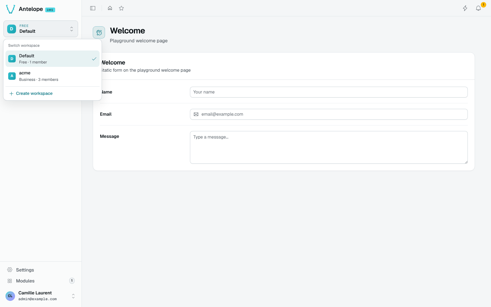
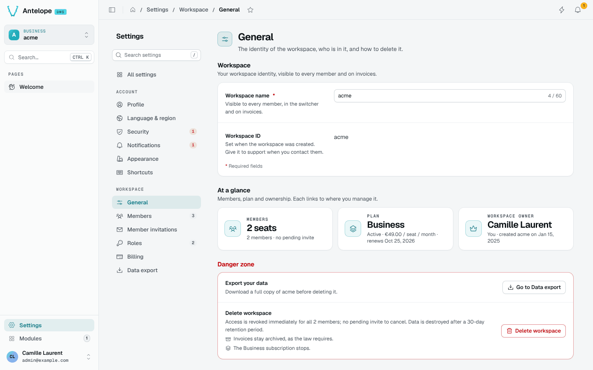
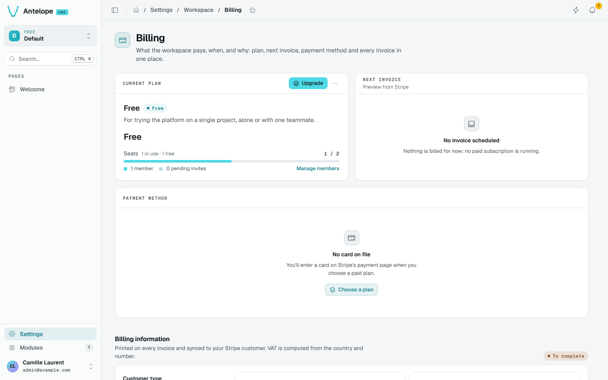
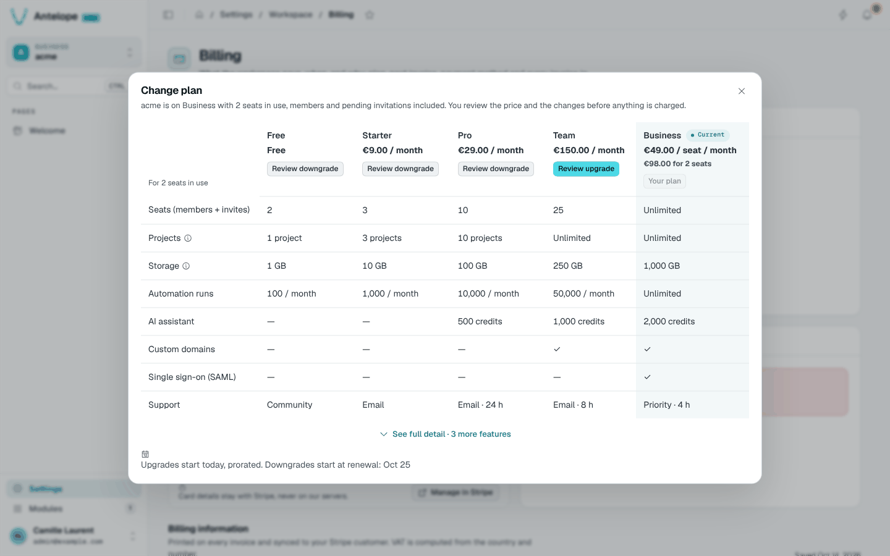
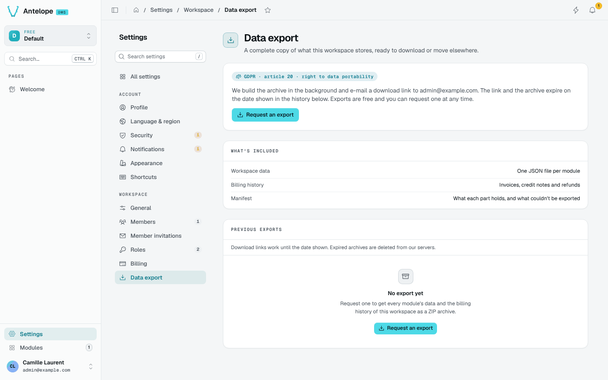

# Workspace settings

dms-saas adds its pages to the DMS **Settings › Workspace** section and a workspace switcher to the sidebar. They are what your customers use.

## Workspace switcher

The switcher at the top of the sidebar shows the current workspace and its plan, lists the other workspaces of the account, and offers **Create workspace** (a new isolated workspace, which requires a card).

## General

The workspace name and id, an **At a glance** row (seats, plan, owner) linking to where each is managed, and a danger zone: export the data first, then delete the workspace. Deletion revokes access at once; data is destroyed after the retention period set in [Billing rules](/docs/modules/saas/usage/billing-rules), and invoices stay archived.

## Members and seats

The DMS Members page gains the seat count of the plan: members and pending invitations each take a seat; expired invitations and platform support members do not. When a workspace is over its plan's seats, members keep access and invitations wait until seats are freed or the plan changes.

## Billing

The Billing page gathers the current plan, the next invoice previewed by Stripe (tax included), the payment method, the billing information printed on invoices, the money-back guarantee when the refund policy allows one, and every invoice and credit note.

**Change plan** (or **Upgrade**) compares the plans side by side for the workspace's current seats. Upgrades start at once, prorated; downgrades start at renewal. Moving from a free plan to a paid one opens Stripe Checkout; see [Starting a paid plan](/docs/modules/saas/stripe#starting-a-paid-plan).

::note
The card itself stays with Stripe: **Manage in Stripe** opens the billing portal, whose return URL must be in `allowedRedirectHosts`.
::

## Data export

Owners request a complete copy of the workspace: one JSON file per module, the billing history, and a manifest. The archive is built in the background, and the download link is e-mailed; links and archives expire on the date shown in the history.

