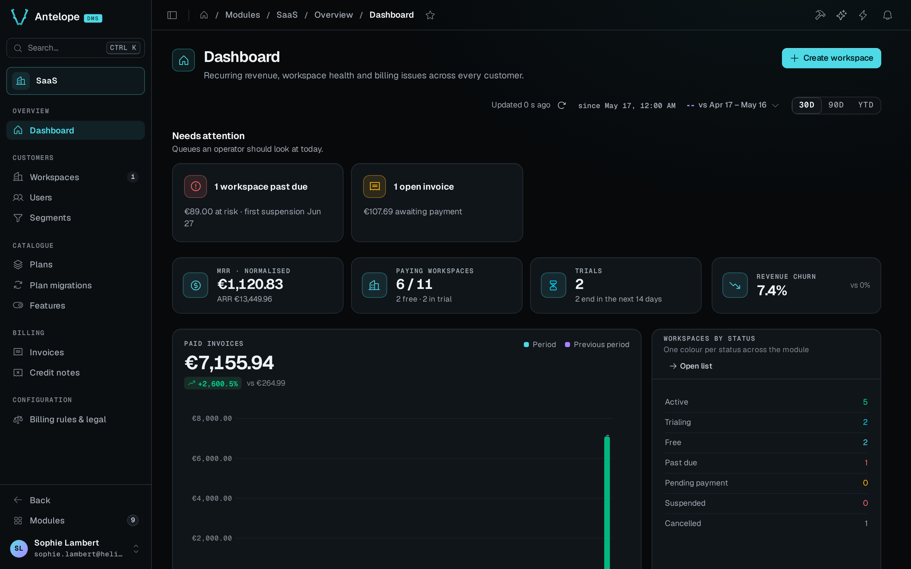

**Modules › SaaS › Dashboard** (`/modules/saas/overview/dashboard`) is the platform owner's landing page. It covers the last 30 days, the last 90 days or the year to date. By default it compares them with the previous period. The bar at the top of the page holds the period, a comparison menu (**vs previous period**, **vs previous year** or **No comparison**), the time the figures were last read, and a refresh button. The module's pages remember the chosen period. With no comparison, the churn and the paid invoices show no change, and the chart draws no comparison line. **Create workspace** in the page header opens a workspace for a customer from the back office.

The page holds these blocks:

- **Needs attention** lists the queues to look at today. They are the workspaces past due, with the amount at risk and the first suspension date, the complimentary accesses ending, the plan migrations that need reconciliation, and the open invoices. Each card opens the matching list.
- The headline figures show the normalised MRR and ARR in the `reportingCurrency`. Yearly plans count for a twelfth of their price, and per-seat plans count their billed seats. Next to them are the paying workspaces out of all workspaces, with the free ones and the ones in trial, and the trials that end in the next 14 days. A workspace is paying when it brings MRR. Free and in trial follow its billing state. These are the same buckets as **Catalogue › Plans**.
- **Revenue churn** counts the workspaces cancelled over the period and the MRR they paid before. A cancellation after a suspension counts the MRR the workspace paid before it fell past due. A workspace the module first sees already cancelled, such as an import or a seed, counts its plan's MRR when it has a paid invoice. It counts nothing when it never paid, like a cancelled trial. The rate divides that loss by today's MRR plus the loss, because the module keeps no MRR history.
- **Paid invoices** draws the money collected and the money credited or refunded over the period, per day up to a quarter and per month beyond. With a comparison, a dashed line shows the money collected over the compared period.
- **Workspaces by status** counts the workspaces in each status, with one colour per status across the module. **Open list** leads to the workspace list.
- **Plans by MRR** ranks the plans by the normalised MRR they bring, and counts only each plan's paying workspaces.
- **Recent activity** lists the latest events, with the tabs **All**, **Billing** and **Lifecycle**.
