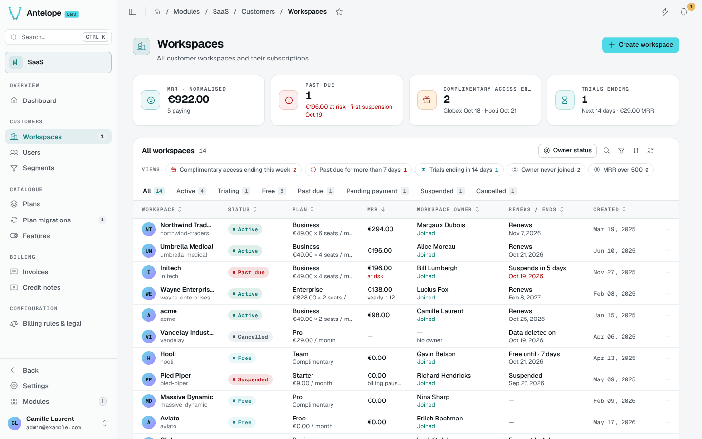
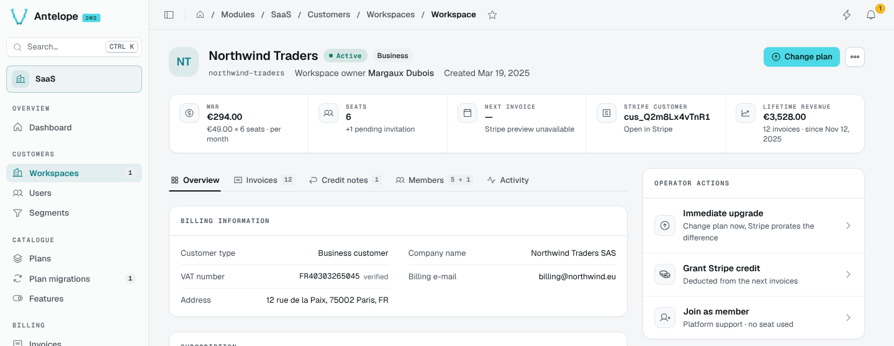

# Workspaces

**Customers › Workspaces** lists every workspace with its status, plan, MRR, owner and renewal or end date.

- **KPIs**: normalised MRR, past due workspaces with the amount at risk, complimentary accesses ending, and trials ending.
- **Views**: saved filters such as complimentary access ending this week, past due for more than 7 days, trials ending in 14 days, owner never joined, MRR over 500.
- **Tabs** by status: active, trialing, free, past due, pending payment, suspended, cancelled.

## Workspace detail

Open a workspace for its header (status, plan, owner, creation date), its figures (MRR, seats, next invoice, Stripe customer, lifetime revenue) and tabs for the overview, invoices, credit notes, members and activity.

The **Operator actions** card offers an immediate upgrade (Stripe prorates the difference), a Stripe credit deducted from the next invoices, joining as a platform support member (no seat used), suspension and reactivation. Internal notes keep the team's context. Each operator action is recorded with an operation id and can be inspected or retried safely; see [Operations](/docs/modules/saas/operations).
