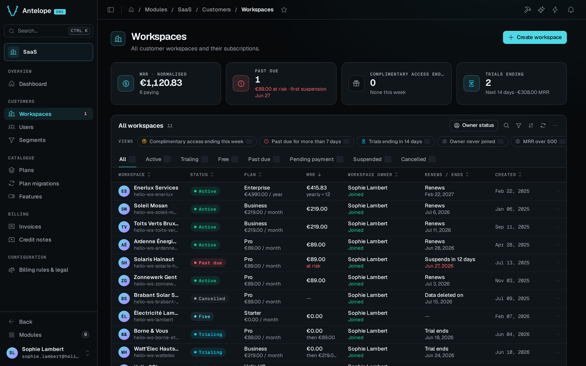
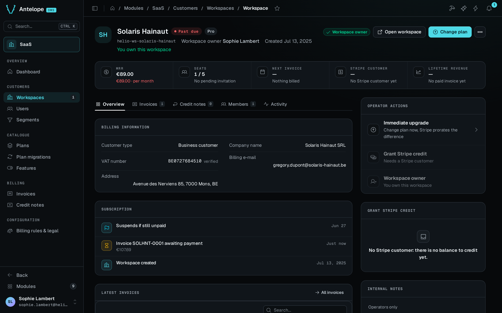

**Customers › Workspaces** (`/modules/saas/customers/workspaces`) lists every workspace with its status, plan, MRR, owner, and renewal or end date. The largest MRR comes first. The search looks at workspace names, owner names and owner e-mails, and a quick filter narrows by owner status. The footer counts the workspaces and totals their MRR in the reporting currency. **Create workspace** in the page header opens a workspace for a customer.

- The headline figures show the normalised MRR, the past due workspaces with the amount at risk, the complimentary accesses ending, and the trials ending.
- The views are saved filters, each with its count: **Complimentary access ending this week**, **Past due for more than 7 days**, **Trials ending in 14 days**, **Owner never joined** and **MRR over 500**.
- The tabs filter by status: **Active**, **Trialing**, **Free**, **Past due**, **Pending payment**, **Suspended** and **Cancelled**. The **Past due** tab shows its count in the menu.
- Each row offers **Open workspace**, **Grant free access…**, **Join as member…** and **Suspend now…**. A cancelled workspace offers neither free access nor suspension, and a suspended one offers no suspension.

## Workspace detail

Open a workspace for its header, with the status, the plan, the owner and the creation date. The figures below it are the MRR, the seats, the next invoice, the Stripe customer and the lifetime revenue. The tabs are **Overview**, **Invoices**, **Credit notes**, **Members** and **Activity**. **Members** also lists the pending invitations, which an operator can resend, copy the link of, or revoke.

The **Operator actions** card offers three actions. **Immediate upgrade** changes the plan now, and Stripe prorates the difference. It needs a paid Stripe subscription. **Grant Stripe credit** adds a credit to the customer balance, deducted from the next invoices. It needs a Stripe customer. **Join as member** adds you as platform support, which uses no seat. **Internal notes** keeps the team's context and is never shown to the customer. The **Danger zone** holds **Suspend workspace**, which blocks every member and pauses Stripe billing, and reactivates a suspended workspace. The header offers **Change plan** on a workspace billed through Stripe, or **Grant free access** on any other. Its **More actions** menu repeats the operator actions, opens the customer in Stripe, copies the workspace link, and suspends or reactivates the workspace.

**Grant complimentary access** offers the plans open to the workspace's customer type, or every plan when the workspace has no customer type. The plan the workspace is on is always offered, even once it is no longer sold, unless it was deleted.

Money-moving actions record an operation ID. Inspect that record before you retry. Only a definitive failure whose executor has finished can be retried. An unknown outcome needs reconciliation, not another click. See [Operations](/docs/modules/saas/operations).
