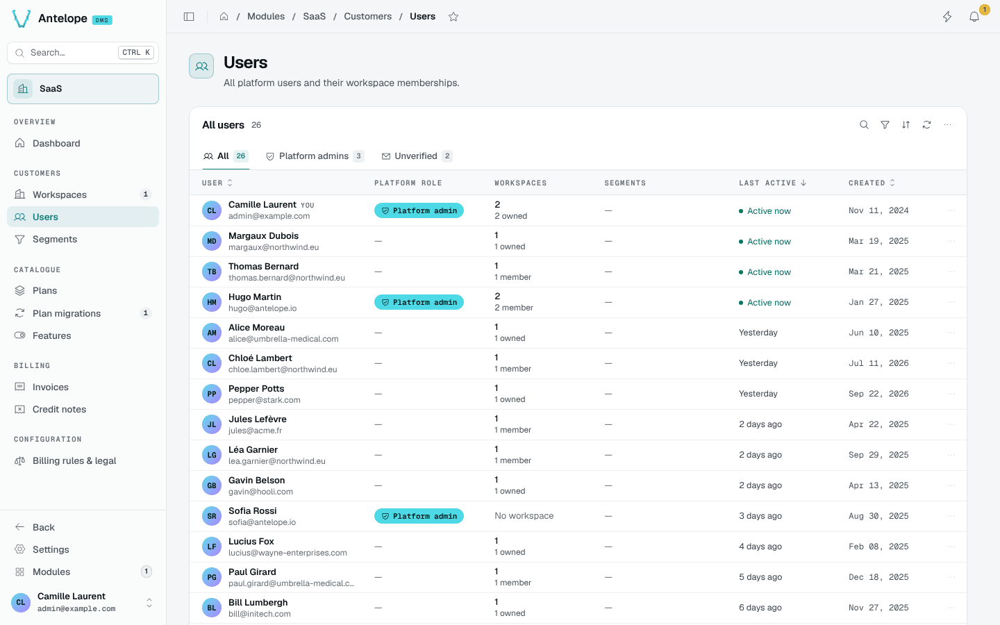
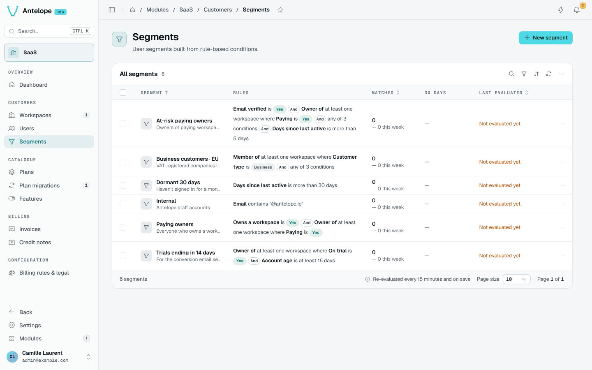

# Users and segments

## Users

**Customers › Users** lists every account with the workspaces it belongs to. A user's detail page shows their memberships, roles and activity.

## Segments

**Customers › Segments** groups users from rule-based conditions: e-mail verified, workspace ownership, paying or trial status of their workspaces, customer type, days since last active, account age, e-mail contents. Conditions combine with **And** and **any of**.

Segments are re-evaluated every 15 minutes and on save. Each shows its matches, the change over the week and when it was last evaluated. They feed campaigns and automations, for example a conversion e-mail to owners whose trial ends in 14 days.
