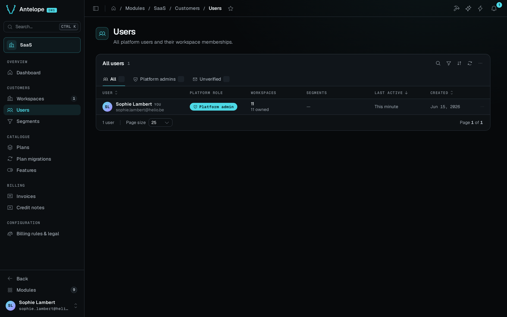
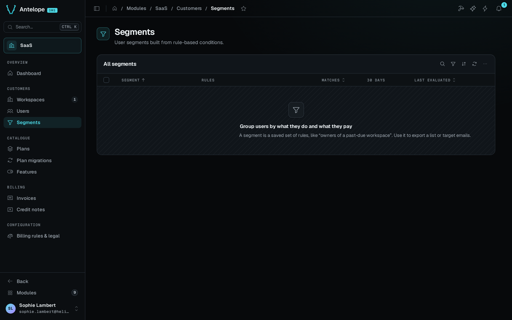

## Users

**Customers › Users** (`/modules/saas/customers/users`) lists every account with its platform role, whether its e-mail address is verified, the workspaces it belongs to, its segments, and when it was last active. The tabs are **All**, **Platform admins** and **Unverified**. A row offers **Promote to platform admin…** or **Demote…**. The last platform admin cannot be demoted, and no admin can demote themselves.

A user's detail page shows the workspaces the user owns or belongs to, the language, the last activity, the sign-up date, and what the user was billed as an owner. Its tabs are **Workspaces**, with the role in each, **Billing** and **Segments**. The side column holds **Security & sign-in**, internal notes and the platform role.

## Segments

**Customers › Segments** (`/modules/saas/customers/segments`) groups users from rule-based conditions. A condition reads a field of the user, such as the e-mail address, whether it is verified, the account age, or the days since the user was last active. A workspace condition reads a field of the user's workspaces, such as the status, the plan, the customer type, or whether it is paying or on trial. It matches when at least one workspace, or every workspace, the user owns or belongs to meets it. Conditions combine with **And** or **Or**, and groups nest.

A workspace's **MRR** and **Paying** conditions read the normalised MRR the dashboard sums. Yearly prices count for a twelfth, and seat prices count the billed seats. Trials, complimentary access, free plans and workspaces not billed (suspended, pending payment, cancelled) count for 0. **Export users (CSV)** writes the e-mail address, the name, the workspaces and `owned_mrr`, which sums that figure over the workspaces the user owns.

Segments are re-evaluated every 15 minutes and on save. **Re-evaluate now** runs one at once. The list shows each segment's rules, its matches, its trend over 30 days with the change this week, and when it was last evaluated. A segment can be duplicated. The editor previews the matching users live before you save.
