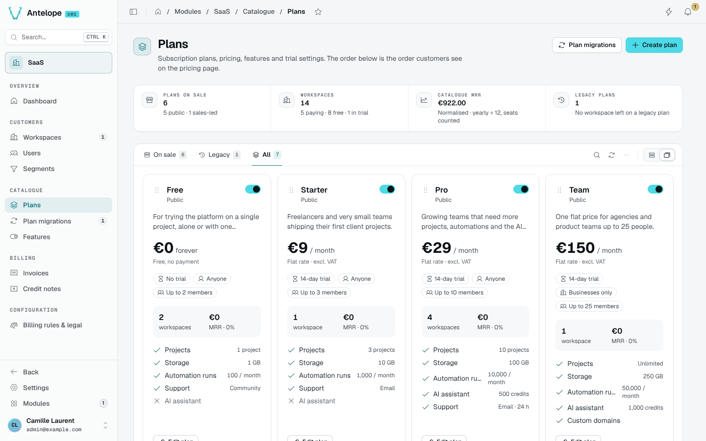
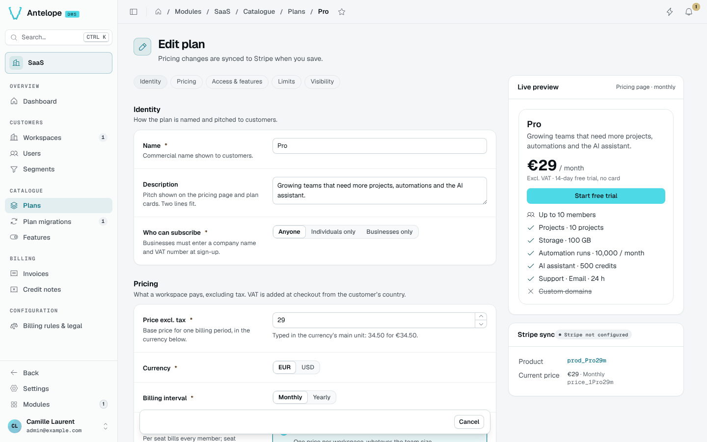
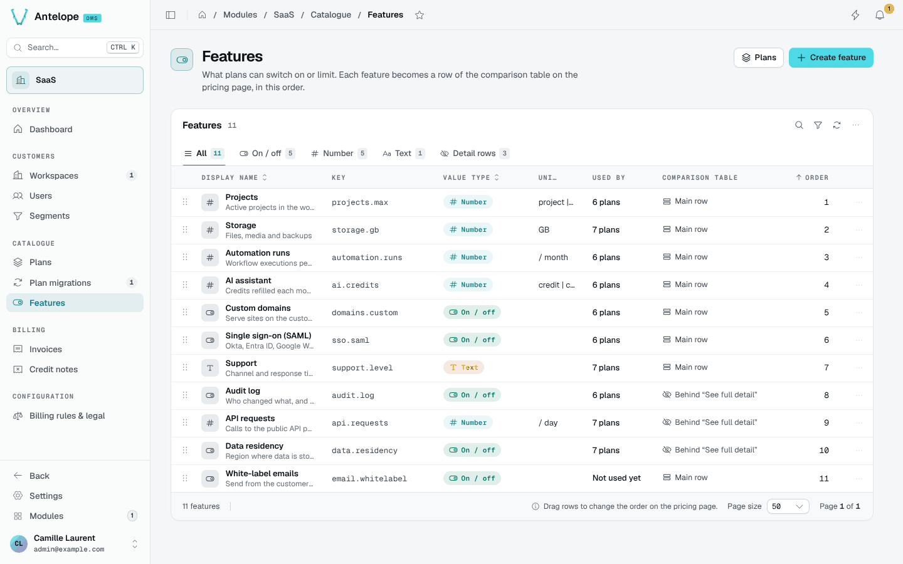
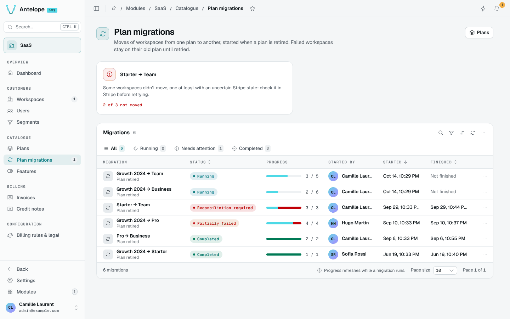

# Plans and features

## Plans

**Catalogue › Plans** shows the plans in the order customers see them on the pricing page, with their price, trial, audience, member limit, features, workspaces and MRR. Drag the cards to reorder them; the switch puts a plan on sale or takes it off.

The tabs separate the plans on sale from legacy ones, which keep their workspaces but are no longer offered.

The **Workspaces** figure counts the live workspaces holding a plan, the same ones the dashboard counts: **paying** brings MRR (active or past due, not complimentary), **free** and **in trial** follow the workspace's billing state, and **other** groups the cancelled, suspended, awaiting a first payment and complimentary ones. A plan card's workspace count includes all of them; the dashboard's **Plans by MRR** counts only the paying ones and says so.

## Plan editor

The editor groups a plan's settings in sections, with a live preview of its pricing card and its Stripe sync state:

- **Identity**: name, description, who can subscribe (anyone, individuals or businesses only).
- **Pricing**: price excluding tax, currency, billing interval, billing mode (flat rate, or per seat with prorated seat changes) and free trial days (no card needed during the trial).
- **Access & features**: the permissions the plan grants (ticking a node of the permission tree adds its descendants and ancestors) and the feature values shown to customers.
- **Limits**: the maximum members. Workspaces already above the cap keep everyone but cannot invite more.
- **Visibility**: on sale (when off, current customers stay but nobody new subscribes), public (listed on the pricing page; hidden plans are assigned by a platform admin), position, and an optional highlight badge such as "Popular".

The description and the badge follow the DMS display-string convention: a value starting with `$` (for example `$myapp.plans.business.badge`) is an i18n key shipped by the module that seeds the plan, translated wherever the plan is shown (`usePlanDisplayText()` in custom screens). The name stays plain text, since Stripe, invoices and e-mails show it as stored. Text fields are saved trimmed.

Saving a billed plan syncs it with Stripe: a changed price creates a new Stripe price and archives the previous one, and existing subscriptions stay on their price. See [Plans and Stripe](/docs/modules/saas/stripe#plans-and-stripe).

## Features

**Catalogue › Features** declares what plans can list: a label and tooltip per language, a value type (boolean, number, text) and a unit. `-1` reads as unlimited, and known units such as bytes or minutes are scaled for reading. Modules can declare their own features and units; see [Extending](/docs/modules/saas/extending#plan-feature-labels-and-values).

## Plan migrations

**Catalogue › Plan migrations** moves every workspace of one plan to another, for example to retire a plan. A migration captures the list of workspaces first, then records an outcome per workspace. An interrupted migration turns to **reconciliation required** rather than replaying effects; see [Operations](/docs/modules/saas/operations).

Completing the captured list does not retire or delete the source plan. New
workspaces may have joined it after capture; retirement requires a separate
procedure that prevents concurrent assignments.

