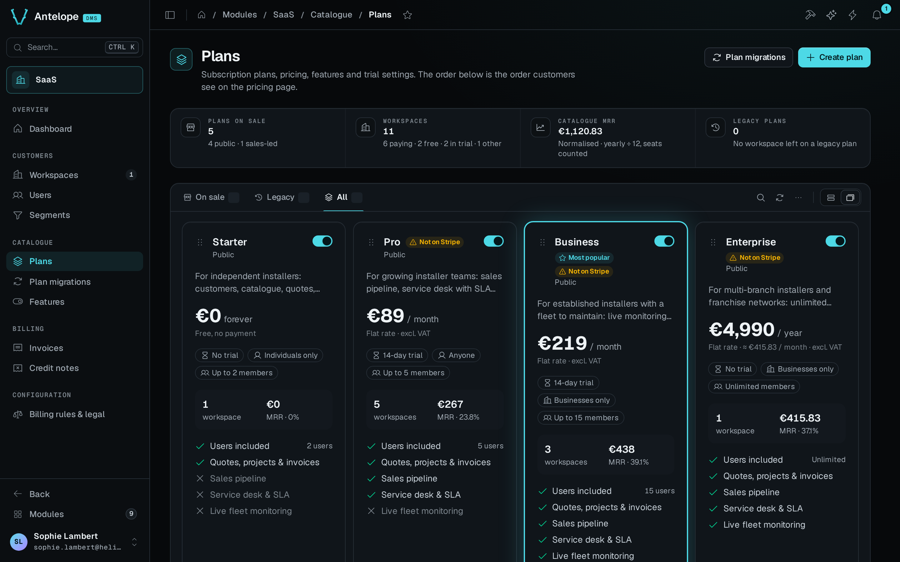
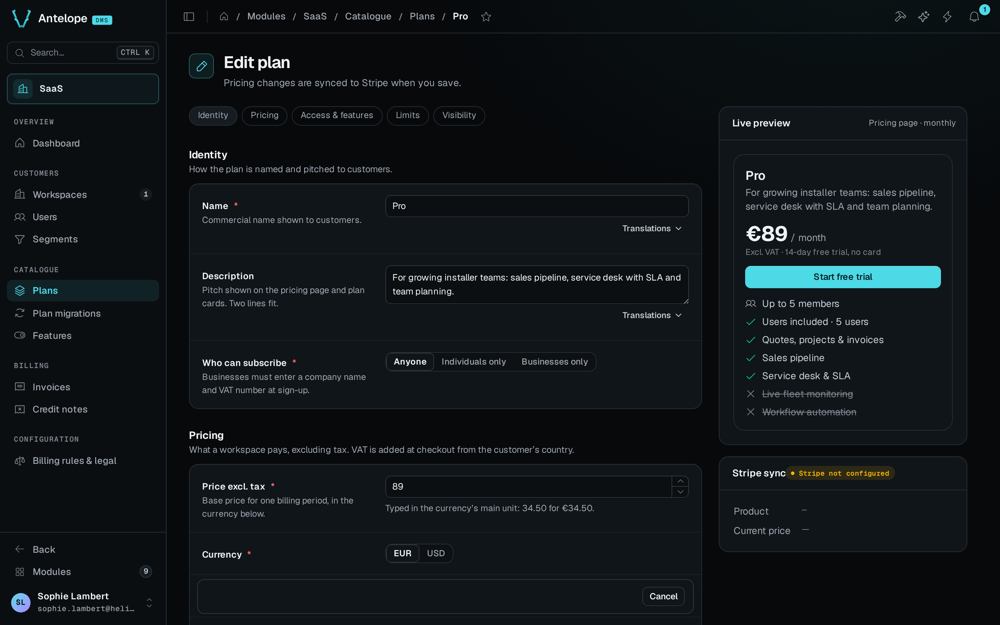
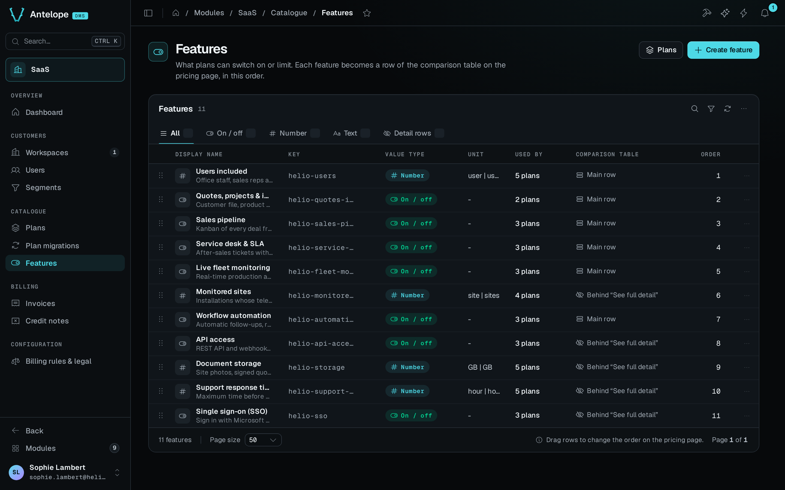
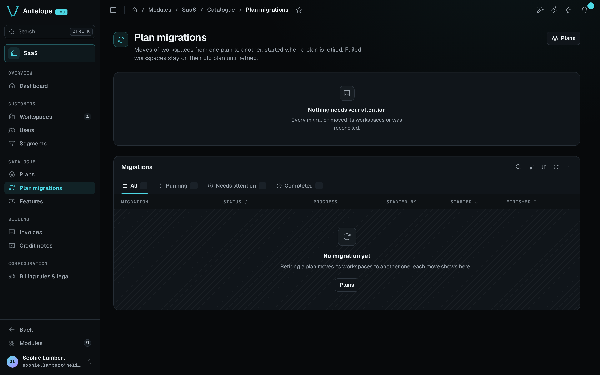

## Plans

**Catalogue › Plans** (`/modules/saas/catalog/plans`) shows the plans in the order customers see them on the pricing page. Each card shows the price, the trial, the audience, the member limit, the features, the workspaces and the share of MRR. Drag the cards to reorder them. The switch on a card puts a plan on sale or takes it off. A page lists eight plans, two rows of cards on a desktop screen. The header holds **Plan migrations** and **Create plan**.

The tabs are **On sale**, **Legacy** and **All**. A legacy plan keeps its workspaces but is no longer offered. The figures above the cards are the plans on sale, the workspaces, the catalogue MRR, and the legacy plans that still hold workspaces.

The **Workspaces** figure counts the live workspaces that hold a plan, the same ones the dashboard counts. **Paying** brings MRR (active or past due, not complimentary). **Free** and **in trial** follow the workspace's billing state. **Other** groups the cancelled, suspended, awaiting a first payment and complimentary ones. A plan card's workspace count includes all of them. The dashboard's **Plans by MRR** counts only the paying ones and says so.

A card's menu offers **Edit plan**, **Duplicate as new plan**, **View workspaces**, **Open product in Stripe**, **Stop selling…** or **Put on sale**, **Retire plan…** and **Delete plan**. **Stop selling…** moves nobody, and current customers keep being billed. **Delete plan** works only once no workspace uses the plan and no scheduled change targets it. It archives the Stripe product.

## Plan editor

The editor (`/modules/saas/catalog/plans/<id>/edit`) groups a plan's settings in sections. A **Live preview** shows its pricing card, and **Stripe sync** shows its Stripe state.

- **Identity** holds the name, the description, and **Who can subscribe** (**Anyone**, **Individuals only** or **Businesses only**).
- **Pricing** holds the price excluding tax, the currency, the billing interval, the billing mode and the free trial days. The billing mode is **Flat rate**, or **Per seat** with prorated seat changes. No card is needed during the trial.
- **Access & features** holds an optional parent plan, the permissions the plan grants, and the feature values shown to customers. A plan built on a parent follows it live, except for the rows it overrides. Ticking a node of the permission tree adds its descendants and its ancestors.
- **Limits** holds the maximum members. Workspaces already above the cap keep everyone but cannot invite more.
- **Visibility** holds **On sale**, **Public**, **Position**, and an optional highlight badge such as "Popular" with its colour. When **On sale** is off, current customers stay but nobody new subscribes. A public plan is listed on the pricing page and at sign-up. A platform admin assigns a hidden plan.

The name, the description and the badge are written once per language, and every screen shows them in the reader's language, falling back to English. Stripe, invoices and e-mails without a reader use the English text. Text fields are saved trimmed.

Saving a billed plan syncs it with Stripe. A changed price creates a new Stripe price and archives the previous one, and existing subscriptions stay on their price. See [Plans and their Stripe products](/docs/modules/saas/stripe#plans-and-their-stripe-products).

## Features

**Catalogue › Features** (`/modules/saas/catalog/features`) declares what plans can list. Each feature has a key, and a name, a description, a tooltip and a unit per language. Its value type is **On / off**, **Number** or **Text**. The value type is locked while plans store a value for the feature. On a number, `-1` reads as unlimited, and known units such as bytes or minutes are scaled for reading. Each feature is a row of the pricing page's comparison table, in the order you drag the rows into. **Hide behind "See full detail"** keeps a row out of the short table. A feature that a plan uses cannot be deleted. Modules can declare their own features and units. See [Extending](/docs/modules/saas/extending#plan-feature-labels-and-values).

## Plan migrations

**Catalogue › Plan migrations** (`/modules/saas/catalog/plan-migrations`) follows the moves of every workspace of one plan to another. **Retire plan…** on a plan card starts one in three steps (**Impact**, **Target plan** and **Confirm**), and you type the plan's key to confirm. Retiring closes the plan to sign-ups at once. A migration captures the list of workspaces first, then records an outcome per workspace. An interrupted migration turns to **Reconciliation required** rather than replaying effects. See [Operations](/docs/modules/saas/operations).

The list has the tabs **All**, **Running**, **Needs attention** and **Completed**. A migration's detail page shows the totals, each workspace with its outcome and its Stripe subscription, what changed for the moved workspaces, and a journal. It offers **Retry failed workspaces**, **Mark as reconciled** and **Export CSV**.

Completing the captured list does not delete the source plan. It stays in the catalogue, and **Delete plan** removes it once no workspace is left on it.

The detail page follows the migration live. The bar at the top shows when it was last read and a **Live** / **Pause** switch. Paused, the page stops reading the changes and counts them until you resume.

