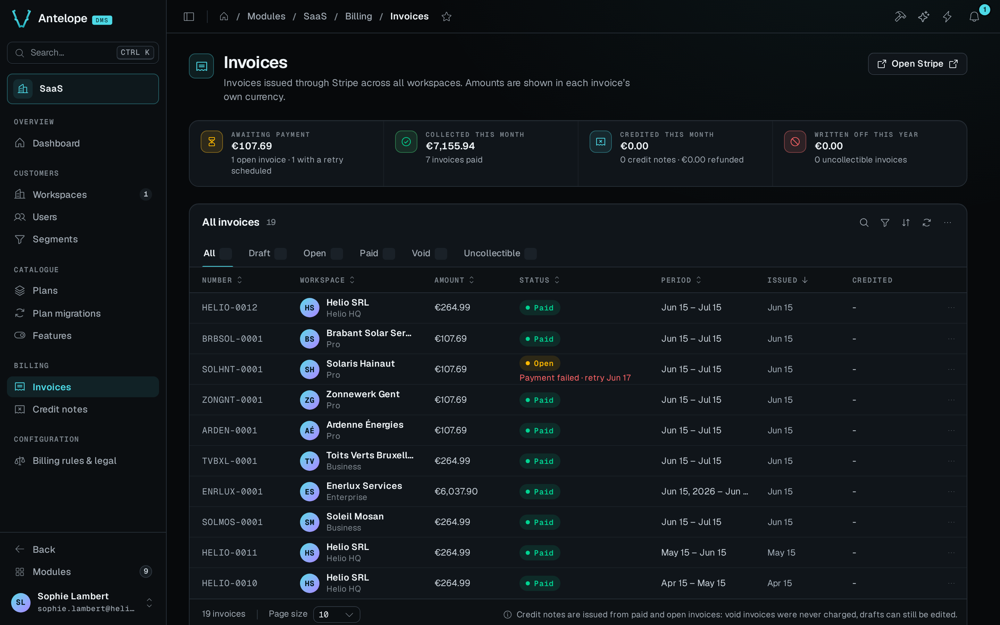
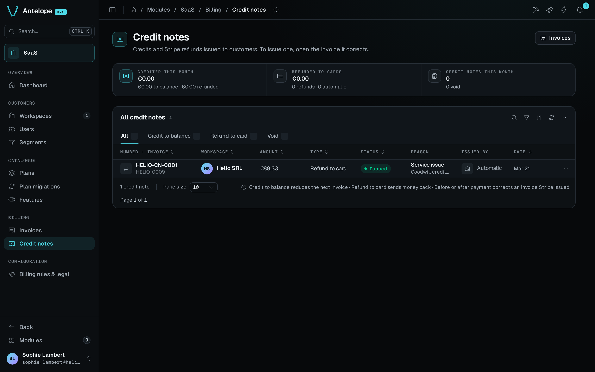

## Invoices

**Billing › Invoices** (`/modules/saas/billing/invoices`) lists the invoices that Stripe issued for every workspace, each in its own currency. The columns are the number, the workspace, the amount, the status, the period, the issue date and the amount already credited. The tabs filter by status: **Draft**, **Open**, **Paid**, **Void** and **Uncollectible**. The search looks at the number and the workspace. **Open Stripe** in the page header opens the invoices in the Stripe dashboard.

The figures above the table are the money awaiting payment, the money collected this month, the money credited this month, and the invoices written off this year.

Each row offers **View details**, **Download PDF**, **Open in Stripe** and, on paid and open invoices, **Issue credit note…**. The details add the due date, the lines, the subtotal, the tax and the payment date. Usage lines that modules add through [invoice line items](/docs/modules/saas/extending#invoice-line-items) appear next to the plan line.

## Issue a credit note

**Issue credit note…** opens on the invoice it corrects and shows what was paid, what was already credited, and what can still be credited. The modes depend on the invoice's status:

- A paid invoice offers **Credit to balance**, deducted from the next invoice, and **Refund to card**, which a second confirmation guards.
- An open invoice offers **Reduce the amount due**, which lowers what the invoice asks and refunds nothing.

The amount cannot exceed what is still creditable. A reason is required, and an internal memo is never shown to the customer. Drafts, void invoices, written-off invoices and fully credited invoices cannot be credited.

## Credit notes

**Billing › Credit notes** (`/modules/saas/billing/credit-notes`) lists the credits and Stripe refunds issued to customers. The columns are the number with the invoice it credits, the workspace, the amount, the type, the status, the reason, who issued it and the date. The tabs are **Credit to balance**, **Refund to card** and **Void**. Refunds that the money-back guarantee or a mid-cycle cancellation trigger appear here as well. The figures are the money credited this month, the refunds to cards, and the credit notes issued this month. To issue a credit note, open the invoice it corrects.

