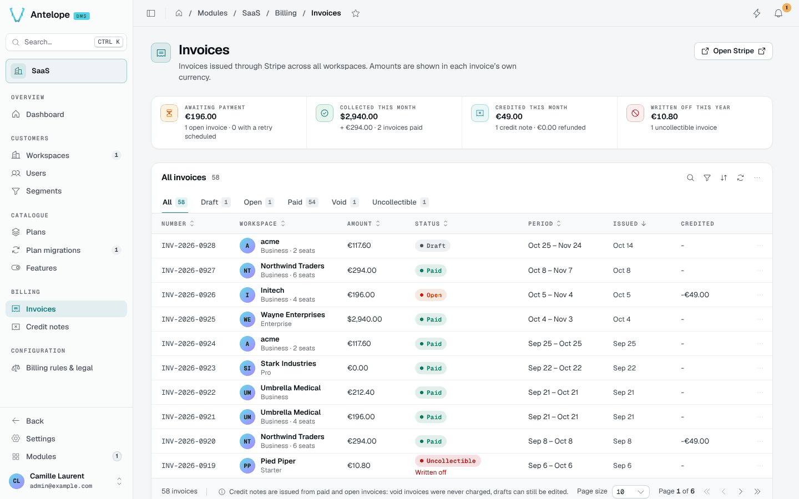
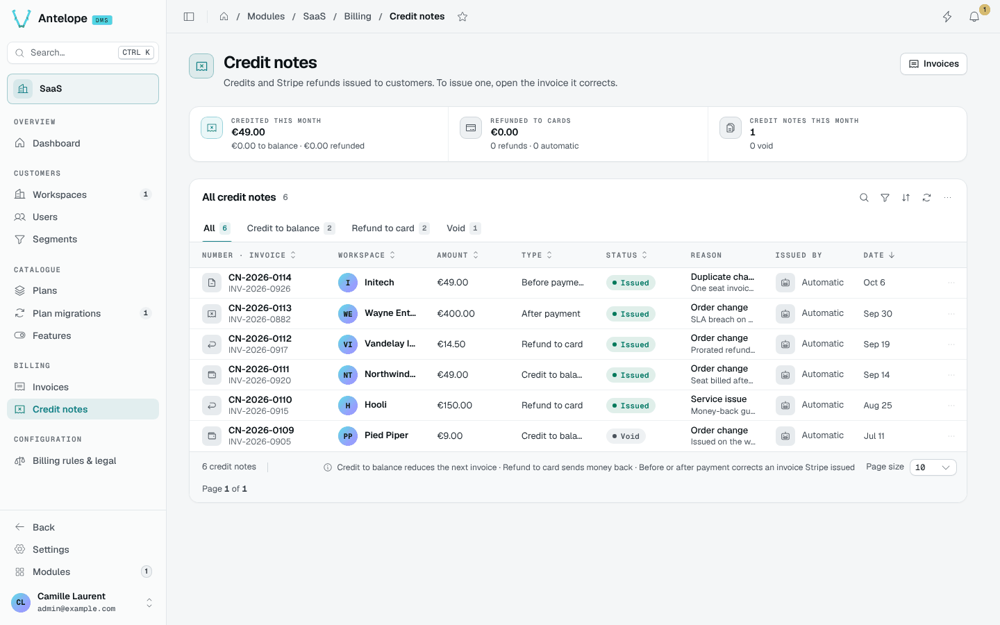

# Invoices and credit notes

## Invoices

**Billing › Invoices** lists the invoices of every workspace, mirrored from Stripe: number, workspace, amount, tax, status (draft, open, paid, void, uncollectible) and dates. Open one for its lines, taxes and payments.

Usage lines that modules add through [invoice line items](/docs/modules/saas/extending#invoice-line-items) appear next to the plan line.

## Credit notes

**Billing › Credit notes** lists the credit notes issued for refunds and corrections, with the invoice they credit.

