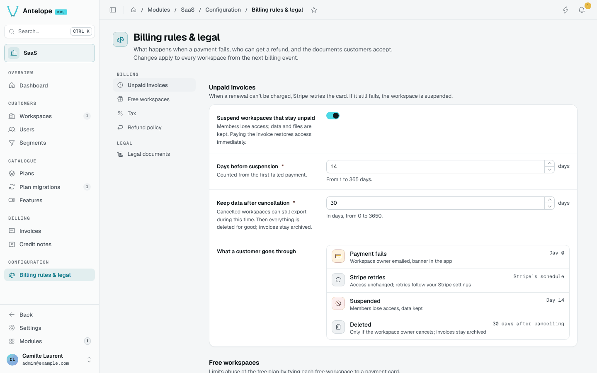

# Billing rules & legal

**Configuration › Billing rules & legal** sets the rules every workspace follows from its next billing event.

| Section | What it sets |
| --- | --- |
| Unpaid invoices | Whether workspaces that stay unpaid are suspended, the days before suspension (counted from the first failed payment), and how long data is kept after cancellation. A timeline shows what a customer goes through. |
| Free workspaces | The free-workspace-per-card cap ("Free workspaces per card"), off by default. When on, every free workspace created in the app needs a card. |
| Tax | How Stripe Tax applies to invoices. |
| Refund policy | Who can get a refund, and the money-back guarantee shown on the Billing page. |
| Legal documents | The terms of use, terms and conditions and privacy policy shown on the public legal pages and accepted at registration. |

::warning
Suspension removes members' access but keeps data and files; paying the invoice restores access at once. Deletion after cancellation is final; invoices stay archived.
::
