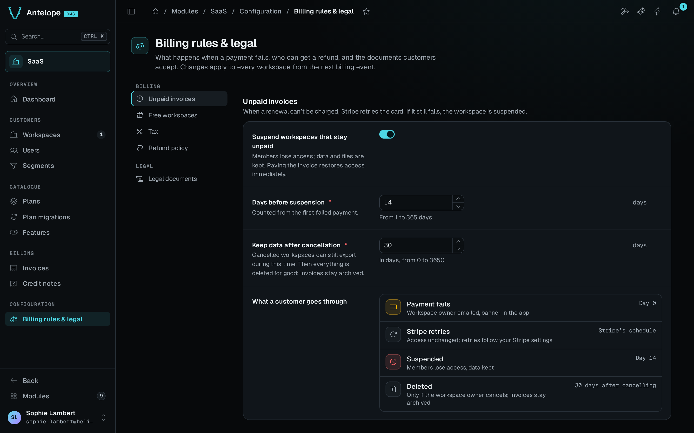

**Configuration › Billing rules & legal** (`/modules/saas/configuration/settings`) sets the rules every workspace follows from its next billing event. The page is one form, saved at once with **Save changes**. Most rules offer their module default.

| Section | What it sets |
| --- | --- |
| Unpaid invoices | Whether workspaces that stay unpaid are suspended (on by default), the days before suspension (1 to 365, counted from the first failed payment), and how long data is kept after cancellation (0 to 3650 days). A timeline shows what a customer goes through. The retention offers no module default, because lowering it deletes workspaces' data. |
| Free workspaces | **Free workspaces per card** (0 to 100, where 0 turns the rule off, the default). Once a card backs that many free workspaces, another free workspace with the same card asks for a paid plan. While the rule is on and Stripe is configured, a free workspace created from the workspace switcher asks for a card that is never charged. |
| Tax | The Stripe tax category (`txcd_` followed by 8 digits) applied to every plan when it is synced to Stripe. Stripe computes the VAT from the customer's country. **Re-sync plans** pushes a saved category to the plans. |
| Refund policy | The money-back guarantee (off by default), its window counted from the first paid invoice (1 to 365 days), and the amount refunded, **Full amount** or **Prorated**. Workspace owners see the guarantee on the Billing page while the window is open. A separate switch, **Refund unused time on cancellation**, refunds the unused days when an owner cancels mid-cycle. |
| Legal documents | The **Terms of use**, **Terms and conditions** and **Privacy policy**. Saving a change publishes a new version. The documents are shown on the public legal pages, linked from sign-up and from the footer of every e-mail. |

::warning
Suspension removes members' access but keeps data and files. Paying the invoice restores access at once. Deletion after cancellation is final, and invoices stay archived.
::
